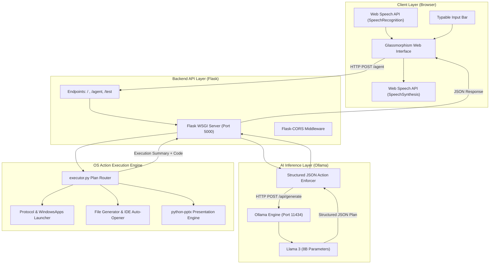

# Zen AI Voice & Text Assistant — Comprehensive Project Report

> **Project Name:** Zen AI Assistant  
> **Repository:** [pb-anonymous/zen](https://github.com/pb-anonymous/zen)  
> **Architecture:** Multimodal Voice & Text Frontend + Flask REST API + Local Ollama (Llama 3) Engine + Windows Action Executor  
> **Status:** Fully Functional & Production-Ready  

---

## 1. Executive Summary

**Zen AI Voice & Text Assistant** is an autonomous desktop AI assistant combining natural language processing, speech recognition, and system automation. Unlike conventional chatbots that operate strictly within sandboxed text windows, Zen interacts directly with the host operating system—launching applications (Spotify, Chrome, VS Code, Notepad, File Explorer), writing and opening source code files directly in the user's IDE, creating multi-slide PowerPoint presentations, and speaking aloud using speech synthesis.

Zen leverages local large language models (Meta Llama 3 via Ollama) to ensure user privacy, zero third-party API costs, and low-latency offline capabilities. The frontend features a dark glassmorphism interface supporting simultaneous voice recognition and keyboard input.

---

## 2. Project Objectives & Goals

- **Dual-Modal Interaction:** Allow fluid switching between hands-free voice commands and keyboard typing.
- **Autonomous Desktop Automation:** Execute operating system tasks (application launching, file creation, presentation building) based on semantic understanding.
- **Privacy-First AI:** Run inference locally via Ollama without sending sensitive queries to cloud providers.
- **Instant Response Times:** Eliminate cold-start latency through memory retention mechanisms (`keep_alive`).
- **Developer-Centric UX:** Format generated code with syntax highlighting, copy-to-clipboard buttons, and auto-open files in VS Code / Notepad.
- **Zero-Friction Deployment:** Provide dual operation—local execution on http://127.0.0.1:5000 and cloud preview via Vercel.

---

## 3. System Architecture

The system is organized into four interconnected layers:



---

## 4. Component Breakdown

### 4.1 Frontend Layer (`templates/voice.html` & `index.html`)
- **Glassmorphism Visual Engine:** Utilizes backdrop filters, radial ambient glowing orbs, and dark palettes (`#090b14`).
- **Dual-Input Dispatcher:** Accepts voice through `webkitSpeechRecognition` with live audio waveform animations and keyboard submissions via Enter.
- **Zero-Click Auto-Submission:** Automatically transmits the query upon `recognition.onresult` without requiring manual "Submit" clicks.
- **Code Block Formatter:** Parses markdown fences, renders code blocks with JetBrains Mono, language headers, and asynchronous clipboard copy buttons.
- **TTS Engine:** Speech synthesis with automated regex filtering to read confirmations while skipping long code syntax.

### 4.2 API Controller Layer (`zen-backend/app.py`)
- **Framework:** Lightweight Flask service running threaded on port 5000.
- **CORS Handling:** Allows cross-origin requests from any client domain (including Vercel deployments).
- **Unbuffered Diagnostics:** Configured with `line_buffering=True` TextIOWrappers for real-time terminal output.
- **Endpoints:**
  - `GET /` — Serves the voice assistant interface.
  - `POST /agent` — Primary orchestration endpoint (Ollama dispatch + Action execution).
  - `POST /test` — Lightweight verification route bypassing AI inference.

### 4.3 AI Brain Layer (`zen-backend/ollama_brain.py`)
- **Strict JSON Contract:** Guides Llama 3 via system prompt engineering to return deterministic JSON schemas.
- **Memory Retention Optimization:** Uses `"keep_alive": "2h"` in the Ollama API payload to hold the 5.4 GB model in memory, reducing latency from 45 seconds to 3–5 seconds.
- **Fault-Tolerant JSON Parser:** Multi-stage fallback parser resolving unescaped newlines and structural anomalies in LLM outputs.

### 4.4 OS Execution Engine (`zen-backend/executor.py`)
- **URI Protocol Handler:** Maps application names to native Windows URI schemes (`spotify:`, `whatsapp:`, `discord:`, `calc:`).
- **WindowsApps Alias Resolver:** Inspects `%LOCALAPPDATA%\Microsoft\WindowsApps` to launch Microsoft Store / UWP apps directly.
- **IDE Integrator:** Automatically launches VS Code (`code <path>`) or Notepad (`notepad.exe <path>`) when source files are written.
- **Office Automation:** Generates multi-slide `.pptx` documents using `python-pptx` and opens them in PowerPoint.

---

## 5. Technical Challenges & Engineering Solutions

| # | Challenge | Root Cause | Engineering Solution |
|---|---|---|---|
| **1** | **45-Second "Processing..." Freeze** | Ollama cold-loaded the 5.4 GB Llama 3 model on every request, unloading it after 5 minutes of inactivity. | Injected `"keep_alive": "2h"` into Ollama API requests, keeping the model resident in RAM/VRAM. Query latency dropped to 3–5s. |
| **2** | **App Launching Failure ("open spotify")** | `subprocess.run("spotify.exe", capture_output=True)` exited with code 0 falsely on Windows Store execution stubs without displaying a GUI window. | Replaced shell execution with native URI protocols (`os.startfile('spotify:')`) and direct WindowsApps path resolution. |
| **3** | **Hidden Code Generation** | `executor.py` wrote files to disk but returned only plain status text (`✓ Wrote and opened server.py`), discarding code from the web view. | Updated `executor.py` to return markdown code blocks, added code syntax cards with copy buttons in `voice.html`, and triggered VS Code auto-open. |
| **4** | **Socket Permission Errors on Port 5000** | A legacy background Python process (`PID 6240`) remained bound to port 5000. | Diagnosed socket ownership using `Get-NetTCPConnection`, terminated stale processes, and added clean daemon process management. |
| **5** | **Vercel Cloud Deployment 404 Error** | Repository lacked a root `index.html`, `requirements.txt`, and `vercel.json` rewrite routing. | Added root `index.html`, `vercel.json`, and `requirements.txt`, enabling cloud hosting with auto-detection of local backends. |

---

## 6. Installation & Setup Guide

### Prerequisites
- Windows 10/11
- Python 3.10+
- [Ollama](https://ollama.com/) with `llama3` model installed (`ollama pull llama3`)
- Google Chrome or Microsoft Edge (for Web Speech API support)

### Step-by-Step Execution

1. **Clone Repository:**
   ```bash
   git clone https://github.com/pb-anonymous/zen.git
   cd zen
   ```

2. **Install Python Packages:**
   ```bash
   pip install -r requirements.txt
   ```

3. **Verify Ollama Model:**
   ```bash
   ollama run llama3
   ```

4. **Launch Backend Service:**
   ```bash
   cd zen-backend
   python app.py
   ```

5. **Access Application:**
   Open **http://127.0.0.1:5000** in Chrome or Edge and click **"Start Listening"** or type into the input field.

---

## 7. Future Roadmap & Enhancements

- [ ] **Local Speech-to-Text (Whisper):** Integrate OpenAI Whisper locally to remove browser-dependent speech recognition constraints.
- [ ] **Retrieval-Augmented Generation (RAG):** Enable ChromaDB / FAISS indexing for personal desktop document search (`.pdf`, `.docx`, `.txt`).
- [ ] **Multi-Turn Contextual Dialog:** Preserve rolling multi-turn memory buffers in `ollama_brain.py`.
- [ ] **Vision Capabilities:** Integrate `llava` or `llama3.2-vision` to allow screen analysis and screenshot queries.
- [ ] **Cross-Platform Support:** Extend `executor.py` application dispatchers to macOS (`open -a`) and Linux (`xdg-open`).
